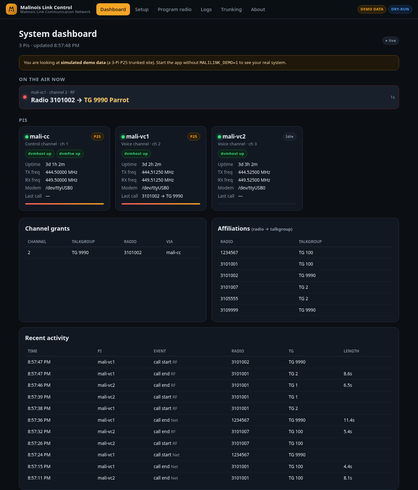

# Malinois Link Control

**Brand:** Malinois Link Communication Network — a friendly web app for setting up and running a
[DVMProject](https://github.com/DVMProject/dvmhost) (`dvmhost` / `dvmfne`) radio system on a
Raspberry Pi 5, without editing YAML by hand. Reach it from your phone over Tailscale.

> **Licensing & use.** Transmitting requires an appropriate license for your frequencies (e.g. an
> amateur radio license). DVMProject software is for personal, non-commercial, hobbyist use and must
> never be used for public-safety or life-safety communications. This app never keys a transmitter by
> itself: it writes configs, starts/stops services when you click, and *reads* status.



## What it does (v0.1)

| Area | Status |
|---|---|
| **Install DVM** (wizard step 1): apt deps → clone → `cmake`/`make` → `make install` → `dvmhost` user → systemd units, as a background job with live progress | ✅ real (dry-run simulation when not on a Pi) |
| **P25 conventional wizard** → `config.yml`, `iden_table.dat`, `talkgroup_rules.yml`, `fne-config.yml` generated from the repo's example files with ruamel.yaml (comments preserved), talkgroups validated against the repo JSON schema | ✅ real |
| **Start/stop** dvmhost / dvmfne via systemd | ✅ real (simulated in dry-run) |
| **Program your radio** page (RX/TX freq, NAC, talkgroups) | ✅ real |
| **Dashboard**: per-Pi status (service, uptime, mode, TX, modem, freqs), who's talking, grants, affiliations, recent calls, live logs | ✅ live data layer + demo data layer |
| **Trunked / multi-Pi** (control channel + voice channels via pairing code) | 🟡 designed; pairing API works, config writing is TODO (`app/pairing.py`) |
| **DMR / NXDN** | 🟡 visible in the wizard as "coming next" |

## Install on the Pi (Raspberry Pi OS Lite, Debian trixie, arm64)

```bash
sudo apt-get install -y git
git clone <this repo> malilink-control && cd malilink-control
sudo ./scripts/install-app.sh          # venv + deps + systemd unit "malilink-control" on :8080
```

Then open `http://<pi-tailscale-name>:8080` and follow **Setup**:
1. **Install DVM** – builds dvmhost/dvmfne (≈15–30 min on a Pi 5; safe to re-run to update).
2. Pick **P25 → Conventional**, enter name/callsign, frequencies, NAC, modem port, network, talkgroups.
3. **Review & save** – see every generated file, tick the two licence/terms boxes, save, start.
4. **Program radio** – values to type into your radio's CPS.

Settings live in `/etc/default/malilink-control` (bind address, port, `MALILINK_PASSWORD` for HTTP
basic auth user `admin`, demo/dry-run). Recommended: `MALILINK_BIND=<your Tailscale 100.x IP>`.
The app runs as **root** (it runs apt, writes `/usr/local/etc`, calls `systemctl`) — keep it on your tailnet.

**Using the Pi's GPIO UART (`/dev/ttyAMA0`)?** Per the dvmhost README, first run:
```bash
sudo systemctl disable bluetooth.service serial-getty@ttyAMA0.service
sudo systemctl mask serial-getty@ttyAMA0.service
echo 'dtoverlay=disable-bt' | sudo tee -a /boot/firmware/config.txt   # trixie path; README says /boot/config.txt
sudo sed -i 's/console=serial0,115200 *//' /boot/firmware/cmdline.txt && sudo reboot
```

## Run anywhere in demo mode

```bash
python3 -m venv .venv && .venv/bin/pip install -r requirements.txt
MALILINK_DEMO=1 .venv/bin/uvicorn app.main:app --port 8080     # http://localhost:8080
.venv/bin/pip install pytest && .venv/bin/python -m pytest -q tests
```
`MALILINK_DEMO=1` = simulated 3-Pi P25 site on the dashboard. **Dry-run** turns on automatically when
`dvmhost`/`systemctl` aren't present (or set `MALILINK_DRY_RUN=1`): configs go to `var/dryrun/etc`,
service actions and the installer are simulated.

## Layout

```
app/
  main.py               FastAPI routes (pages + JSON API, SSE stream)
  settings.py, state.py env settings, JSON state (var/state.json)
  configgen/            generate.py (config.yml/fne-config.yml), iden.py (freq math), talkgroups.py (+schema)
  services/             systemd.py (start/stop/status), installer.py (Install DVM background job)
  data/                 base.py (interface), live.py, demo.py, dvmrest.py (read-only REST client), logparse.py
  pairing.py            trunking pairing API (design + stub)
  templates/, static/   Jinja pages + vanilla JS/CSS (no build step)
dvm_templates/          example configs + schema + dvmhost.service copied from dvmhost (SOURCE.txt = commit)
systemd/                malilink-control.service, dvmfne.service
scripts/                install-app.sh, refresh_templates.sh
tests/                  test_smoke.py, fake_dvmhost.py (fake REST server for manual testing)
```

## How it talks to DVM (verified in dvmhost source)

* REST (`src/host/restapi`, `src/fne/restapi`): `PUT /auth {"auth": sha256_hex(restPassword)}` → `token`;
  then header `X-DVM-Auth-Token`. Used read-only: `GET /status`, `/p25/report-affiliations`, `/voice-ch`.
  The client refuses any path not on a read-only allow-list (no `/mdm/mode`, `/grant-tg`, `/p25/rid`, `/p25/raw-tsbk` …).
* dvmhost REST on `127.0.0.1:9990`; dvmfne REST moved to `9991` (both default to 9990).
* Logs: `<filePath>/DVM-YYYY-MM-DD.log` and `.activity.log` (activity lines `A: <ts> P25 RF|Net …`).
* Config parsing quirks honoured: `channelNo`, `nac`, `netId`, `sysId`, `rfssId`, `siteId` are hex strings;
  `voiceChNo` must not be empty; iden offset must be non-zero (simplex uses `simplexSameFrequency`).

## Multi-Pi / trunking design
See **Trunking** page and `app/pairing.py`. Control Pi issues a 10-minute code → new Pi calls
`/api/pairing/join` → control's `/api/pairing/claim` allocates the next channel number and returns a
bundle (site IDs, CC RPC, FNE creds, cluster key) and adds the Pi to the dashboard, which aggregates
each Pi's `/api/local/snapshot`. TODO: write `voiceChNo` + restart on the CC, write the VC config, enable P25 CC.
