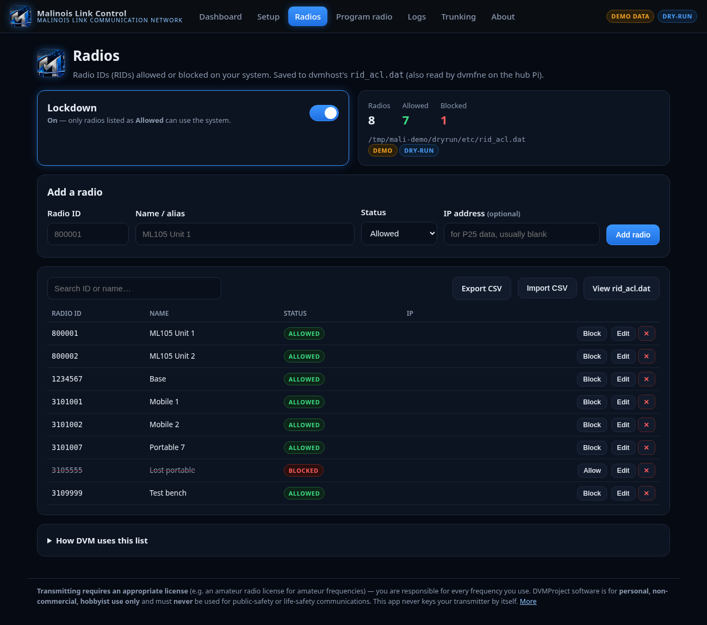

<p align="center"></p>

# Malinois Link Control

**Brand:** Malinois Link Communication Network — a friendly web app for setting up and running a
[DVMProject](https://github.com/DVMProject/dvmhost) (`dvmhost` / `dvmfne`) radio system on a
Raspberry Pi 5, without editing YAML by hand. Reach it from your phone over Tailscale.

> **Licensing & use.** Transmitting requires an appropriate license for your frequencies (e.g. an
> amateur radio license). DVMProject software is for personal, non-commercial, hobbyist use and must
> never be used for public-safety or life-safety communications. This app never keys a transmitter by
> itself: it writes configs, starts/stops services when you click, and *reads* status.


## What it does (v0.3)

| Area | Status |
|---|---|
| **Install DVM** (wizard step 2, after Welcome): apt deps → clone → `cmake`/`make` → `make install` → `dvmhost` user → systemd units, as a background job with live progress | ✅ real (dry-run simulation when not on a Pi) |
| **P25 conventional wizard** → `config.yml`, `iden_table.dat`, `talkgroup_rules.yml`, `fne-config.yml` generated from the repo's example files with ruamel.yaml (comments preserved), talkgroups validated against the repo JSON schema | ✅ real |
| **Start/stop** dvmhost / dvmfne via systemd | ✅ real (simulated in dry-run) |
| **Program your radio** page (RX/TX freq, NAC, talkgroups) | ✅ real |
| **Dashboard**: per-Pi status (service, uptime, mode, TX, modem, freqs), who's talking, grants, affiliations, recent calls, live logs | ✅ live data layer + demo data layer |
| **P25 trunked, multi-Pi**: wizard "Trunked" makes this Pi the control channel; extra Pis use "Add this Pi as a voice channel" + a pairing code. The control Pi assigns the channel, rewrites its `voiceChNo` list and restarts dvmhost; the voice Pi writes its own VC config pointing back at the control Pi | ✅ implemented, tested in dry-run (not yet on RF hardware) |
| **Radios page** (RID manager): add / edit / delete radio IDs with a name, Allowed/Blocked, search, CSV import/export, **Lockdown** toggle → writes dvmhost's real `rid_acl.dat` + `system.radio_id.acl` | ✅ real; trunked: control Pi pushes the list to every voice Pi |
| **"Load my previous system values"** preset on the Setup welcome screen (ML105 trunked system) | ✅ fills the wizard (see mapping below) |
| **DMR / NXDN** | 🟡 visible in the wizard as "coming next" |
| Branding: Malinois Link logo in header, favicon, About and the setup welcome screen | ✅ |

## Install on the Pi (Raspberry Pi OS Lite, Debian trixie, arm64)

```bash
sudo apt-get install -y git
git clone <this repo> malilink-control && cd malilink-control
sudo ./scripts/install-app.sh          # venv + deps + systemd unit "malilink-control" on :8080
```

Then open `http://<pi-tailscale-name>:8080` and follow **Setup**:
1. **Install DVM** – builds dvmhost/dvmfne (≈15–30 min on a Pi 5; safe to re-run to update).
2. Pick **P25 → Conventional**, enter name/callsign, frequencies, NAC, modem port, network, talkgroups.
3. **Review & save** – see every generated file, tick the two licence/terms boxes, save, start.
4. **Program radio** – values to type into your radio's CPS.

Settings live in `/etc/default/malilink-control` (bind address, port, `MALILINK_PASSWORD` for HTTP
basic auth user `admin`, demo/dry-run). Recommended: `MALILINK_BIND=<your Tailscale 100.x IP>`.
The app runs as **root** (it runs apt, writes `/usr/local/etc`, calls `systemctl`) — keep it on your tailnet.

**Using the Pi's GPIO UART (`/dev/ttyAMA0`)?** Per the dvmhost README, first run:
```bash
sudo systemctl disable bluetooth.service serial-getty@ttyAMA0.service
sudo systemctl mask serial-getty@ttyAMA0.service
echo 'dtoverlay=disable-bt' | sudo tee -a /boot/firmware/config.txt   # trixie path; README says /boot/config.txt
sudo sed -i 's/console=serial0,115200 *//' /boot/firmware/cmdline.txt && sudo reboot
```

## Run anywhere in demo mode

```bash
python3 -m venv .venv && .venv/bin/pip install -r requirements.txt
MALILINK_DEMO=1 .venv/bin/uvicorn app.main:app --port 8080     # http://localhost:8080
.venv/bin/pip install pytest && .venv/bin/python -m pytest -q tests
```
`MALILINK_DEMO=1` = simulated 3-Pi P25 site on the dashboard. **Dry-run** turns on automatically when
`dvmhost`/`systemctl` aren't present (or set `MALILINK_DRY_RUN=1`): configs go to `var/dryrun/etc`,
service actions and the installer are simulated.

## Layout

```
app/
  main.py               FastAPI routes (pages + JSON API, SSE stream)
  settings.py, state.py env settings, JSON state (var/state.json)
  configgen/            generate.py (config.yml/fne-config.yml), iden.py (freq math), talkgroups.py (+schema)
  services/             systemd.py (start/stop/status), installer.py (Install DVM background job)
  data/                 base.py (interface), live.py, demo.py, dvmrest.py (read-only REST client), logparse.py
  pairing.py            trunking pairing API (codes, claim, join, remove)
  radios.py             Radios page API (RID list, lockdown, CSV, sync to voice Pis); configgen/ridacl.py = file format
  templates/, static/   Jinja pages + vanilla JS/CSS (no build step)
dvm_templates/          example configs + schema + dvmhost.service copied from dvmhost (SOURCE.txt = commit)
systemd/                malilink-control.service, dvmfne.service
scripts/                install-app.sh, refresh_templates.sh
tests/                  test_smoke.py, test_radios.py, test_pairing.py (2-3 live app processes), test_dvm_yaml.py,
                        dvmyaml/ (dvmhost YAML parser checker), fake_dvmhost.py (fake REST server)
docs/screenshots/       UI screenshots
```

## How it talks to DVM (verified in dvmhost source)

* REST (`src/host/restapi`, `src/fne/restapi`): `PUT /auth {"auth": sha256_hex(restPassword)}` → `token`;
  then header `X-DVM-Auth-Token`. Used read-only: `GET /status`, `/p25/report-affiliations`, `/voice-ch`.
  The client refuses any path not on a read-only allow-list (no `/mdm/mode`, `/grant-tg`, `/p25/rid`, `/p25/raw-tsbk` …).
* dvmhost REST on `127.0.0.1:9990`; dvmfne REST moved to `9991` (both default to 9990).
* Logs: `<filePath>/DVM-YYYY-MM-DD.log` and `.activity.log` (activity lines `A: <ts> P25 RF|Net …`).
* Config parsing quirks honoured: `channelNo`, `nac`, `netId`, `sysId`, `rfssId`, `siteId` are hex strings;
  `voiceChNo` must not be empty; iden offset must be non-zero (simplex uses `simplexSameFrequency`).

## Radios (RID access list)



Nav → **Radios**. Each entry is a radio ID (1–16777215), a name, and **Allowed**/**Blocked**.

| You do | What is written |
|---|---|
| add / edit / delete / block a radio | `rid_acl.dat` next to `config.yml` (`/usr/local/etc`), one line per radio: `RID,1|0,Name,IP,` + the repo's comment header + trailing blank line |
| Lockdown **off** | `system.radio_id.acl: false` → everybody may talk **except** radios marked Blocked |
| Lockdown **on** | `system.radio_id.acl: true` → **only** radios listed as Allowed may talk/register |
| CSV import | merge or replace; columns `rid,alias,enabled,ip` (also accepts `Radio ID,Name` sheets and pasted `rid_acl.dat` lines) |

Verified in dvmhost source:
* format — `configs/rid_acl.example.dat` + `RadioIdLookup::load()` (comma split, `#` comments, enabled = field 2 `== 1`,
  no quoting → commas are stripped from names);
* config keys — host reads only `system.radio_id.file`, `time`, `acl` (`Host.cpp`); there is **no `enable` key**.
  dvmfne reads `system.radio_id.file`/`time` and always builds its table with ACL on (`HostFNE.cpp`);
  both point at the same file on the hub Pi, so one write covers both;
* allow/block logic — `AccessControl::validateSrcId()` (P25/DMR/NXDN): ACL off → only listed+disabled are refused;
  ACL on → anything not listed+enabled is refused;
* reloads — the lookup thread re-reads the file every `time` minutes (`LookupTable.h`; template value 2), so list
  edits apply **without a restart**. `acl` is read only at start-up, so the Lockdown switch shows
  **Restart dvmhost now** when dvmhost is running (restart = a few seconds off-air; it never keys the transmitter).
  The app refuses Lockdown with zero allowed radios.

Trunked: the control Pi is the source of truth. The list + lockdown go to a new voice Pi in its pairing bundle and
are pushed to every paired voice Pi (`POST /api/radios/sync`, cluster key) on each change; voice Pis show it
read-only. (DVM's own mechanism — the FNE pushing whitelist/blacklist to peers with `network.updateLookups` —
is not used because it only toggles IDs and drops names; `updateLookups` stays off.) The FNE REST
`/rid/*`, `/reload-rids` endpoints exist but aren't called (the app's REST client is read-only).

API: `GET/POST /api/radios`, `PUT/DELETE /api/radios/{rid}`, `POST /api/radios/lockdown {enabled, restart?}`,
`POST /api/radios/import {csv, mode}`, `GET /api/radios/export.csv`, `GET /api/radios/rid_acl.dat`,
`POST /api/radios/apply {restart}`.

## "Load my previous system values" preset

| Value | Wizard field → config key |
|---|---|
| P25 trunked, this Pi = control channel | topology `trunked` |
| WACN A1055 / System ID 105 / RFSS 1 / Site 1 | `system.config.netId: A1055`, `sysId: 105` (hex, as written), `rfssId: 1`, `siteId: 1` |
| NAC 105 decimal | `nac: 069` (hex) |
| Channel ID 2, 450 MHz, 6.25 kHz | matches row `2,450000000,6.25,5.000,12.5` of the repo iden table (+5 MHz offset) → `channelId: 2` |
| Control 2-385 | `channelNo: 385` → TX 455.63125 / RX 460.63125 MHz (hex, how dvmhost parses it). The preset lets you pick **decimal** instead → 452.40625 / 457.40625 MHz |
| Voice 2-457 | voice Pi join: "Use my previous voice channel" → TX 456.94375 MHz (hex) or 452.85625 (decimal), peer 900003 |
| TG 101 "ML105 Main" | `talkgroup_rules.yml` |
| CW ID ML105 | `system.cwId.callsign` (also used as system name) |
| FNE peer 900001 | `fne-config.yml master.peerId` (new "Hub (FNE) peer ID" field) |
| CC host peer 900002 | `network.id` |
| VC host peer 900003 | new "First voice-channel peer ID" field → handed out to the first paired VC (then 900004… if free) |
| Console peer 900004 | **not configured by the app** — enter it in your console software; it connects to dvmfne with the hub password (peer ACL off) |
| RIDs 800001, 800002 + lockdown | Radios list replaced and `radio_id.acl: true` when you save Setup |

**Unverified:** whether your old "105" system ID and "385/457" channel numbers were hex (config.yml) or decimal
(radio programming) — check the frequencies shown before saving. Note the VC peer 900003 and an auto-assigned 2nd VC
would collide with console peer 900004; give a 2nd VC an explicit peer ID on its join screen.

## Trunked P25 across several Pis

1. **Control Pi:** Setup → P25 → **Trunked** → finish the wizard (it always runs dvmfne). dvmhost will
   not start until at least one voice channel is paired (dvmhost refuses an empty `voiceChNo`).
2. **Trunking → Create pairing code** (10 min, single use).
3. **Each voice Pi:** install the app, Setup → **Add this Pi as a voice channel**, enter
   `http://<control-pi>:8080`, the code, its modem port and (optionally) a specific TX frequency.
4. The control Pi gives it the next free channel (`step = bandwidth / spacing`, i.e. 12.5 kHz apart) on
   the same identity row, regenerates its config with the new `voiceChNo` entry and restarts dvmhost if
   running. The voice Pi writes its config, `iden_table.dat` and `talkgroup_rules.yml`; you start it from
   its dashboard. Remove a VC from the control Pi's Trunking page.
5. The control Pi's dashboard pulls every voice Pi's status/logs via `/api/local/*` (cluster key).

Generated key combinations:

| | Control channel | Voice channel |
|---|---|---|
| `protocols.p25.control.enable / dedicated` | true / true | false / false |
| `system.config.authoritative / supervisor` | true / true | false / false |
| `system.config.controlCh` | left at default (`rpcPort: 0`) | `rpcAddress`=control Pi IP, `rpcPort: 9890`, `rpcPassword`, `notifyEnable: true` |
| `system.config.voiceChNo` | one entry per VC (`channelId`, hex `channelNo`, VC `rpcAddress`, 9890, `rpcPassword`) | own channel only |
| `network` | → local dvmfne, `rpcAddress: 0.0.0.0` | → control Pi's dvmfne, `id` = "First voice-channel peer ID" (counting up) or peerId + chNo, `rpcAddress: 0.0.0.0` |

Verified in source: the keys and how they're parsed (`Host.Config.cpp`, `p25/Control.cpp`), VC→CC
notification needs address + non-zero port + `notifyEnable`, `dedicated` only applies with
`control.enable`, `supervisor` only read when `authoritative`, and RPC uses SHA-256(`rpcPassword`) as the
pre-shared key (`NetRPC.cpp`) → **one shared rpcPassword** across the system. The CC/VC
authoritative/supervisor/dedicated values match the repo's own `tools/dvmcfggen` templates.
**Unverified:** that this combination trunks correctly on air (not run on hardware), whether a VC needs
its own channel in `voiceChNo`, and Tailscale/UDP RPC behaviour between Pis.

`tests/dvmyaml/` builds a tiny checker against dvmhost's own YAML parser
(`tests/dvmyaml/build.sh /path/to/dvmhost`); `tests/test_dvm_yaml.py` then parses the generated CC, VC
and conventional configs with it (skipped if not built).
